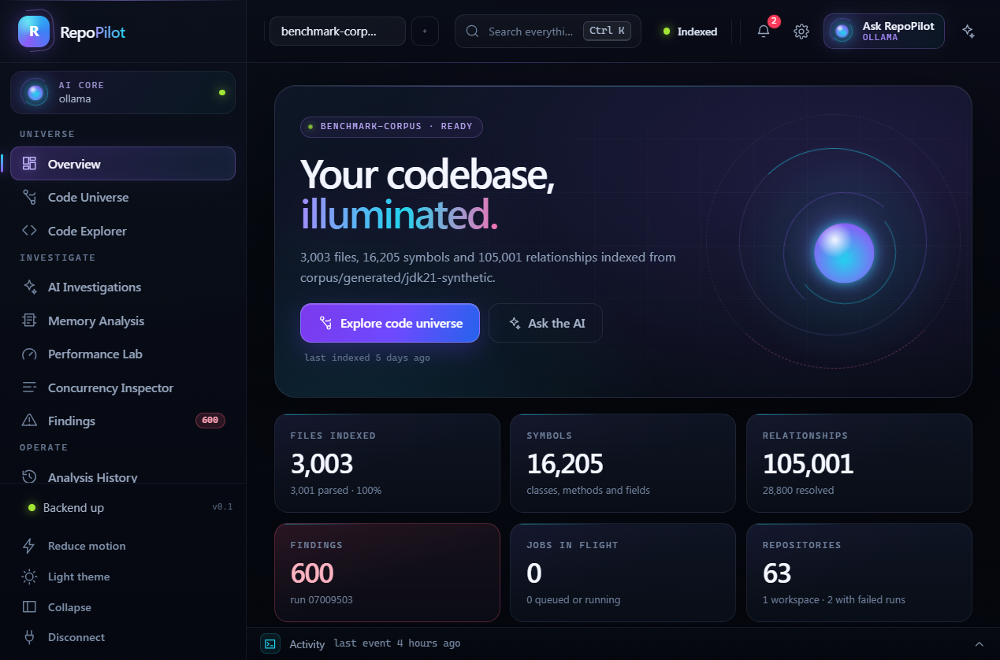

# RepoPilot

A local-first code-intelligence and performance-analysis workbench for Java repositories.

RepoPilot indexes a Java codebase on your machine, reports exactly what it understood and
what it could not, and lets you investigate real measurements — not summaries. It runs with
zero external dependencies: no cloud account, no API key, no telemetry. The default model
provider is a local [Ollama](https://ollama.com) instance, and every AI claim is checked
against indexed evidence by the backend before you see it.



## Screenshots

| Screen | What to look at |
| --- | --- |
| [Code Explorer — coverage](docs/screenshots/code-explorer-coverage.png) | `3,001 parsed · 1 parsed with problems · 1 recorded · 5 not read`, and the sentence underneath: *"Inspected 3,008 files: 3,002 read; 1 recorded without an analyzer; 5 deliberately not read (3 credential files, 2 unrecognised language files)."* |
| [Code Explorer — findings](docs/screenshots/code-explorer-findings.png) | Fourteen findings from `fixtures/quality-demo`: severity, rule id, and a `LINE CONFIRMED` verdict on every citation |
| [Finding detail](docs/screenshots/finding-detail.png) | One finding in full — why it matters, what to do, and *what this rule cannot see* |
| [Nothing analysed yet](docs/screenshots/findings-not-analysed.png) | The zero state. "Not analysed" is a different screen from "found nothing", and the wording says which one you are looking at |
| [Code Explorer — references](docs/screenshots/code-explorer-references.png) | Incoming and outgoing references for a symbol, each with its resolution status |
| [Dependency Graph](docs/screenshots/dependency-graph.png) | The type/reference graph, coloured by resolution |
| [Dependency Graph — bounded](docs/screenshots/dependency-graph-bounded.png) | The graph view on a 3 000-file repository: `1,000` of `100,801` matching edges, with the banner stating that the counts describe the slice |
| [Analysis History](docs/screenshots/analysis-history.png) | Every job with its outcome summary, attempts and duration |
| [Performance Lab — upload](docs/screenshots/performance-lab-upload.png) | A recording is stored by content hash on this machine; the panels underneath count what a run produced |
| [Performance Lab — run](docs/screenshots/performance-lab-run.png) | One run in full: kind breakdown, the summary, and *"No threshold was applied and no severity was assigned"* followed by the recording's provenance — JVM, build, OS, CPU, memory |
| [Performance Lab — measurements](docs/screenshots/performance-lab-measurements.png) | Measurements with scope, kind, value with its unit, reduction and sample count; the scope column is the only one clipped, and only visually |
| [Performance Lab — a thread dump](docs/screenshots/performance-lab-thread-dump.png) | The same screen reading a different artefact kind: `17 TOTAL`, `THREAD-DUMP-READER=1.0.0`, and provenance rows for when the dump was taken, threads with and without a Java state, and the deadlock cycles the JVM reported |
| [Concurrency Inspector](docs/screenshots/concurrency-inspector.png) | Which dump the report describes, the census (60 thread blocks, 42 with a Java state, 18 of the JVM's own), and the file with its hash |
| [Concurrency Inspector — states](docs/screenshots/concurrency-inspector-states.png) | All four states with their share of Java threads and the detail the dump gave (`2 on object monitor`, `1 parking`), and the caveat underneath: *HotSpot reports a thread blocked in a native call … as `RUNNABLE`, so this is not a count of threads using a CPU* |
| [Concurrency Inspector — deadlock](docs/screenshots/concurrency-inspector-deadlock.png) | A cycle the JVM's own detector reported, as thread → monitor → holder edges, and *"RepoPilot repeated them; it did not search for the cycle itself"* |
| [Concurrency Inspector — empty](docs/screenshots/concurrency-inspector-empty.png) | The zero state names the command to take a dump, and states that `jcmd Thread.dump_to_file` is refused in both its formats, and why |
| [Performance Lab — a heap dump](docs/screenshots/performance-lab-heap-dump.png) | Selecting *Heap Dump* before upload: the process-memory warning, and the three readings a heap run produces (`61` measurements from a 9.6 MB dump, `7` metric families, `HEAP-DUMP-READER=1.0.0`) |
| [Memory Analysis](docs/screenshots/memory-analysis.png) | One heap dump: 71,754 objects holding 4.1 MB of recorded data across 827 types, the largest single object (`256 KB of byte[]`) and the file with its hash |
| [Memory Analysis — the census](docs/screenshots/memory-census.png) | The three parts of the heap with their object counts, recorded bytes and share of the whole, under the basis: *"the bytes are what the dump recorded for the objects themselves: field values and element data, with no object header and no class metadata"* |
| [Memory Analysis — types by bytes](docs/screenshots/memory-types-bytes.png) | The largest types by recorded bytes, with shares, and the disclosure underneath: `20 of 827 type(s) shown` |
| [Memory Analysis — what it is not](docs/screenshots/memory-roots.png) | The GC roots by kind (1,342 roots: `sticky-class`, `jni-global`, `java-frame`, `thread-object`) and the footer: the census is of the objects the process was *still holding* — taking a dump collects first — with no retained size, no rate, no threshold and no severity |
| [Memory Analysis — empty](docs/screenshots/memory-empty.png) | The zero state gives the two commands that write a dump, and states that a gzip stream and a class histogram are refused by name |
| [Performance Lab — a benchmark result](docs/screenshots/performance-lab-benchmark-upload.png) | Selecting *Benchmark Result* before upload: only the `-rf json` array is read, and the JVM's arguments are counted rather than stored |
| [Performance Lab — a benchmark run](docs/screenshots/performance-lab-benchmark-run.png) | `277` measurements from `14` entries, `BENCHMARK-READER=1.0.0`, the harness's own summary — and the banner: *"Quoted from the benchmark harness — not measured here"* |
| [Performance Lab — benchmark provenance](docs/screenshots/performance-lab-benchmark-provenance.png) | JMH `1.37` on JDK `21.0.5`, the three modes, `jvmArgs` `0 in the file, none stored` with the reason, `6` entries with no per-iteration values, and *comparisons made: no* |
| [Performance Lab — a quoted score](docs/screenshots/performance-lab-benchmark-measurements.png) | One score expanded: `10.359 ops/us`, reduction `as reported`, and the basis — *"quoted from the benchmark result file … No threshold was applied and no severity was assigned"* — beside the check that it is the mean of the 6 per-iteration values across 2 forks |
| [Performance Lab — the artefact](docs/screenshots/performance-lab-benchmark-artifact.png) | `BENCHMARK RESULT`, `277` measurements from one file, and the job list now naming `BENCHMARK_IMPORT` alongside the three other runtime readers |
| [Settings](docs/screenshots/settings.png) | Connection, sandbox roots, AI provider status, privacy controls |
| [Settings — artefact retention](docs/screenshots/settings-retention.png) | The window (`30` days), what is stored (`1 (281 KB)`), what a pass would remove, and *"Nothing is past this window"* instead of a bare empty table |
| [Command palette](docs/screenshots/command-palette.png) | `Ctrl K` |
| [Capability page](docs/screenshots/capability-not-available.png) | What an unimplemented destination says instead of showing empty results |
| [Overview](docs/screenshots/overview.png) | Repository inventory, job activity and system status |

---

## Why it exists

Most code-intelligence tools answer with a number that is impossible to audit: *"4 213
issues found"*, *"fully analysed"*, *"no problems detected"*. You cannot tell whether a
finding is a compiler fact, a static-analysis heuristic, a profiler sample, or a language
model's plausible guess — and the tool rarely tells you, because the four are not the same
kind of claim.

RepoPilot is built around the opposite assumption. Every statement the product makes is
labelled by how it was obtained, and the backend — never the model — decides whether a
citation is real:

| Label | Meaning | Produced by |
| --- | --- | --- |
| **Confirmed observation** | A fact read out of the index: a file, a symbol, a line, a resolved reference | JavaParser + the resolver |
| **Static-analysis finding** | A rule fired, with the rule identified | PMD / SpotBugs / built-in checks |
| **Runtime measurement** | A number sampled from a process, a recording or a dump of it | JFR, thread dumps, heap dumps, benchmarks |
| **AI hypothesis** | A model's proposal, shown with its evidence and never as fact | Ollama |

A file that fails to parse is reported as `PARSED_WITH_PROBLEMS`, never as "parsed". A
reference the resolver cannot prove is reported as `INFERRED`, and one it can prove is
`RESOLVED` with the target symbol attached. A skipped credential file is counted as
excluded, with the reason, rather than quietly omitted. See
[Evidence model](#the-evidence-model) below for how far this is implemented today.

---

## Status

RepoPilot is built in phases and this repository is an honest snapshot of that progress.
Everything marked **Working** has been exercised end to end; everything marked
**Not yet** is declared in the product but has no backend behind it, and the UI says so
rather than pretending.

| Area | State | Notes |
| --- | --- | --- |
| Workspace + repository registration | **Working** | Sandboxed roots, path-traversal and symlink defence |
| Durable job system | **Working** | `QUEUED → RUNNING → SUCCEEDED/FAILED/CANCELLED`, bounded workers, cancellation, recovery on restart |
| Repository indexing | **Working** | Two-pass scan, JavaParser without a symbol solver, batched persistence, measured on a 3 000-file corpus |
| Coverage reporting | **Working** | Inspected vs. read vs. deliberately-not-read, with per-reason breakdowns |
| Reference resolution | **Working** | `RESOLVED` / `INFERRED` / `EXTERNAL` / `UNRESOLVED`; exact qualified-match only |
| Code Explorer | **Working** | Files, source with line numbers, symbols, references, API mappings, findings |
| Dependency Graph | **Working** | Type/reference graph with resolution status per edge |
| Static analysis — built-in rules | **Working** | Eight rules (`RP001`–`RP008`) parsed once per file; every finding carries its rule, its citation and its stated limitation |
| Static analysis — PMD | **Working** | PMD 7.28.0's bundled quickstart ruleset, in-process, with file content fed to PMD rather than collected by it |
| Static analysis — SpotBugs | **Not yet** | Needs bytecode. `compiledClassesPresent` is recorded per revision, so it will report *not applicable* with the precondition attached rather than a pass |
| Findings in the UI | **Working** | Findings tab: filters by severity, category, analyzer, file and text; per-file counts; click through to the citation |
| Analysis History | **Working** | Every job, its outcome summary and its errors |
| Settings | **Working** | Connection, workspace roots, AI provider status, privacy switches |
| Bearer-token auth, loopback bind | **Working** | Single-operator model; CSRF disabled by design ([ADR 0005](docs/adr/0005-auth-model.md)) |
| Runtime evidence — JFR ingestion and reading | **Working** | Upload a recording, stored by SHA-256 under `<data-dir>/artifacts`; the JDK's Flight Recorder API reads it in process. 101 measurements from a 3.3 s live recording |
| Runtime evidence — measurement model | **Working** | `runtime_measurement`: unit, kind, reduction (`COUNT`/`SUM`/`MEAN`/`MAX`/`AS_REPORTED`), sample count, scope and per-metric caveats. No thresholds, no severity, no percentiles — by design ([ADR 0008](docs/adr/0008-runtime-evidence.md)) |
| Runtime evidence — Performance Lab | **Working** | Run header, provenance, measurements filtered by family and kind, artefacts with their support status. Hosts all four readers, and the family filter follows the artefact type |
| Runtime evidence — thread dumps | **Working** | The plain-text `Thread.print` / `jstack` / `kill -3` dump: thread states, monitor contention and the deadlocks the JVM's own detector reported. The two `Thread.dump_to_file` formats are refused by name — they carry no states and no lock ownership, so a report from them would be zeros ([ADR 0009](docs/adr/0009-thread-dump-evidence.md)) |
| Concurrency Inspector | **Working** | One analysed dump: states with share bars and the `RUNNABLE` caveat, deadlock cycles as thread → monitor → holder, the contention table, and the depth/held maxima. No thresholds, no severity |
| Runtime evidence — heap dumps | **Working** | The binary HPROF file `jmap`, `jcmd GC.heap_dump` and the OOM hook write, read in two passes: the class table, then the heap. A gzip stream, a class histogram and a thread dump are each refused by name, with the command that produces a readable file ([ADR 0010](docs/adr/0010-heap-dump-evidence.md)) |
| Memory Analysis | **Working** | One analysed dump: the census (instances, arrays and their recorded bytes), the two type tables with their shares and the `TOP_N = 20` disclosure, the GC roots by kind, and the largest single object. **No retained size, no leak verdict, no threshold, no severity** — every byte row states its basis |
| [Local AI provider abstraction](docs/adr/0002-local-first-ai.md) | **Partial** | Ollama client, health, capability reporting. No investigation flow yet |
| Runtime evidence — benchmark results | **Working** | The JSON array `-rf json` writes, from JMH and harnesses that follow it. Every score, error, confidence bound and percentile is quoted `AS_REPORTED` with the harness's own unit; the JVM's arguments are counted and not stored ([ADR 0011](docs/adr/0011-benchmark-evidence.md)) |
| Benchmark import in the UI | **Working** | The run card says the figures are the harness's, not this build's; provenance lists modes, parameters, iteration times, JMH and JDK versions, and *comparisons made: no* |
| Artefact retention | **Working** | A purge removes the stored **file** of an artefact past the window; the row, the run and every measurement are kept. The plan is computed live and *is* the dry run; a zero-day window is refused rather than read as "everything" ([ADR 0012](docs/adr/0012-artefact-retention.md)) |
| Benchmark regression / baseline view | **Not yet, by design** | One upload states one run, and RepoPilot holds no baseline to compare it with. Nothing in the product claims a delta it did not measure |
| AI investigation with citation checking | **Not yet** | The evidence rules are designed; the flow is not implemented |
| Embeddings / pgvector | **Not yet** | Off by default; deliberately not started without a proven need |

Submitting a job type that has no handler returns a clear `UNSUPPORTED_INPUT` error instead
of queueing work that can never run. The one destination without a backend — AI investigation —
renders an explicit capability page.

---

## Quickstart

### Option 1 — Docker Compose

```bash
docker compose up --build
```

Then open <http://localhost:3000>. The stack is PostgreSQL, the backend and an nginx-served
frontend; all published ports are bound to loopback.

On first start, if `REPOPILOT_AUTH_TOKEN` is not set, the backend generates a token and
writes it to `/data/token.txt` inside the backend container:

```bash
docker compose exec backend cat /data/token.txt
```

Paste that token into the connection gate in the UI.

> **Verification note.** The container files in this repository are written but were not
> executed here: the environment this snapshot was built in has no Docker daemon. The
> backend image, the nginx configuration and the Compose file have been reviewed and the
> frontend production build has been run and verified, but `docker compose up --build`
> itself is **unverified**. Treat it as the intended path and report what you see.

### Option 2 — local, from source

Requirements: JDK 21, Maven (or the bundled `mvnw`), Node 20+.

```bash
# backend — H2 file database, no external services needed
cd backend
./mvnw spring-boot:run          # Windows: .\mvnw.cmd spring-boot:run

# frontend — a second terminal
cd frontend
npm install
npm run dev                     # http://localhost:5173
```

The backend binds `127.0.0.1:8080` by default. On first start it prints and stores a
generated token at `<data-dir>/token.txt`; alternatively set `REPOPILOT_AUTH_TOKEN` before
starting. The dev server proxies `/api` and `/actuator` to the backend, so no CORS
configuration is needed in development.

To point RepoPilot at the sample repository in this repo:

```powershell
$env:REPOPILOT_WORKSPACE_ROOTS = "C:\Users\you\Projects\repo-pilot"
$env:REPOPILOT_AUTH_TOKEN      = "a-token-you-choose-16-chars-min"
cd backend
.\mvnw.cmd spring-boot:run
```

Register `examples/sample-java` in the UI and press **Index**. See
[scripts/smoke-test.ps1](scripts/smoke-test.ps1) for the same flow driven from the shell.

> Windows note: `powershell` blocks unsigned `.ps1` files by default. Every script here
> should be invoked as
> `powershell -NoProfile -ExecutionPolicy Bypass -File .\scripts\<name>.ps1`.

---

## How it works

RepoPilot is a modular monolith: packages by feature, one deployable backend, no premature
service boundaries ([ADR 0001](docs/adr/0001-modular-monolith.md)).

```
                    ┌──────────────────────────── frontend (React + TS, strict) ──────┐
                    │  Overview · Code Explorer · Dependency Graph · History · Settings│
                    │  Performance Lab · Concurrency Inspector · Memory · AI (planned) │
                    └───────────────────────────────┬──────────────────────────────────┘
                                          bearer token │ /api/v1
                    ┌───────────────────────────────▼──────────────────────────────────┐
                    │ api/v1   thin controllers, no business logic                      │
                    │ ─────────────────────────────────────────────────────────────────│
   durable job ────▶│ jobs     queue · workers · lifecycle · cancellation · recovery    │
   queue            │ ─────────────────────────────────────────────────────────────────│
                    │ codeindex  scan → parse → resolve → persist → query              │
                    │ repository sandbox · revisions · coverage                         │
                    │ workspace  registration and allow-listed roots                    │
                    │ ai         AiProvider abstraction (Ollama default)                │
                    │ security   bearer auth · rate limit · sandbox validation          │
                    │ shared     clock · errors · correlation ids · persistence base    │
                    └───────┬──────────────────────────────┬───────────────────────────┘
                            │                              │
                     PostgreSQL (or H2, `local`)      Ollama at :11434 (optional)
```

Two decisions shape most of the code:

- **Blocking work is explicit.** Persistence is Spring Data JPA; the web layer is WebFlux.
  Every blocking call is offloaded through `Blocking.offload(...)`, so a slow query can
  never stall an event-loop thread ([ADR 0003](docs/adr/0003-webflux-with-blocking-jpa.md)).
- **Transactions are short.** No database transaction is held across a parse batch, an LLM
  call, or an artifact scan ([ADR 0006](docs/adr/0006-transaction-boundaries.md)). Indexing
  writes in bounded batches so memory stays flat regardless of repository size.

Indexing itself is a two-pass walk:

1. **Enumerate and fingerprint** — the sandbox walker decides what it is willing to read,
   records why it refused everything else, and hashes the included files. Nothing is parsed
   while the file list is being built.
2. **Parse and persist** — files are re-read in bounded batches, parsed, resolved against
   the revision's declared types, and written with the symbols, references and API mappings
   derived from them.

Full detail: [docs/architecture.md](docs/architecture.md).

---

## The evidence model

The rules that make the four claim types distinguishable:

- **Citations are validated by the backend, not the model.** Every static finding's line range
  is checked against the text that was analysed before it is stored, and each finding is
  stamped `SOURCE_CONFIRMED` (the cited lines exist), `LOCATION_STALE` (the rule reported a
  line the file does not have — a defect in the rule, shown loudly rather than clamped into
  range) or `NO_LOCATION_CLAIMED`. *(For model output the same check is designed but not
  implemented: the AI investigation flow does not exist yet.)*
- **A finding states what it cannot see.** `limitations` is required and non-blank on every
  finding, and the UI renders it beside the recommendation, because a rule's boundary is part
  of its claim rather than a footnote to it.
- **Two engines stay distinguishable.** PMD's `EmptyCatchBlock` and RepoPilot's `RP001` both
  fire on the fixture's empty catch, and both are stored. `analyzerId` is never merged away,
  so "two independent engines agree on this line" is something you can check rather than
  assume.
- **A re-run appends; it does not overwrite.** Findings are keyed to an analysis run, so
  re-analysing a repository after a change leaves the previous result readable by run id
  instead of erasing the history that made the comparison meaningful.
- **Line `0` means "not recorded".** The parser writes `0` when JavaParser had no position
  for a node, and the UI renders that as `—`, never as a plausible line number.
- **Resolution is proven, not guessed.** A reference is `RESOLVED` only on an exact
  qualified-name match, or an exact same-package match verified against the declared types
  of the revision. Generics and array suffixes are normalised for lookup but never invented:
  `List<String>` never becomes `com.example.List` or `java.util.ArrayList`. Explicit imports
  are not tracked, so an unimported cross-package reference stays `INFERRED`.
- **Absence of a measurement is reported as absence.** SpotBugs needs bytecode; RepoPilot
  does not compile repositories behind your back, so a revision without build output is
  reported as *not applicable* with the precondition recorded (`compiledClassesPresent`),
  rather than as a pass.
- **Recorded is not parsed.** A `.properties` or `.yml` file is read, hashed and stored with
  status `RECORDED` and no symbols. It is deliberately *not* run through the Java parser,
  which had produced a Java syntax verdict about files that are not Java and labelled every
  `application.properties` as "parsed with problems".
- **Nothing is claimed about files that were never read.** The scan report distinguishes
  files that were read, files that were inspected and deliberately skipped (with reasons),
  and directories that were never walked — because a pruned directory hides an unknown
  number of unseen files, and turning that into a count would be inventing one.

---

## What indexing actually produces

Measured on this machine against the generated corpus
([details and method](corpus/RESULTS.md)):

| Metric | Value |
| --- | --- |
| Java files indexed | 3 002 |
| Files inspected | 3 008 |
| Files deliberately not read | 5 (`SECRET_BEARING=3`, `UNSUPPORTED_LANGUAGE=2`) |
| Files recorded without an analyzer | 1 (`application.properties`) |
| Symbols | 16 205 |
| References | 105 001 |
| References resolved with a proven target | 28 800 |
| API mappings | 2 400 |
| End-to-end index span | 158 s, 172 s and 190 s over three runs (≈16–19 files/s) |
| Peak process working set | 897–946 MiB, observed by the OS (includes the JVM baseline, not indexing growth alone) |
| Average CPU during the run | 8.7–10.1 % of 12 logical cores (≈1 core busy) |
| Database size after indexing | 73 MiB on disk for 3 003 files and 105 001 references |

Host: 13th Gen Intel i5-1335U, 12 logical cores, 16 GiB RAM, NVMe SSD, JDK 21.0.5, H2 file
database, single indexing worker.

The corpus is generated from a seed
([scripts/generate-corpus.ps1](scripts/generate-corpus.ps1)) so those numbers are
reproducible rather than anecdotal. It also contains fixtures that a well-formed corpus
would not: three credential files that must be excluded before any read, two files in
languages RepoPilot does not parse, and one deliberately broken Java file that must be
reported as `PARSED_WITH_PROBLEMS` rather than as a parse failure or a success.

Reproduce it with:

```powershell
powershell -NoProfile -ExecutionPolicy Bypass -File .\scripts\generate-corpus.ps1
powershell -NoProfile -ExecutionPolicy Bypass -File .\scripts\measure-index.ps1 -RepositoryId <uuid>
```

---

## What analysis actually produces

Measured on the same machine, read back through the public API
([method](scripts/measure-analysis.ps1)):

| Metric | Benchmark corpus | Quality fixture |
| --- | --- | --- |
| Files analysed | 3 002 | 3 |
| Findings | 600 | 14 |
| Findings confirmed against the file | 600 of 600 | 14 of 14 |
| Analysis span | 118 s | 3.3 s |
| Peak process working set | 770 MiB (OS-observed, includes the JVM baseline) | 676 MiB (warm JVM, so not comparable) |

The corpus figure is a scale measurement, not a quality one. The corpus was generated for
indexing volume, so 600 of its 600 findings are PMD's `ClassNamingConventions` firing on enum
constants written in `SCREAMING_SNAKE_CASE`. That suspiciously round number was checked
independently against the corpus — it contains exactly 600 such declarations — because a
count that round is either the whole truth or a truncation, and the only way to tell is to
count it another way.

[`fixtures/quality-demo`](fixtures/quality-demo/README.md) is the other half of the evidence:
one deliberate instance of each built-in rule, one clean file, two overlaps with PMD, and a
fake credential that must never appear in a response. The analysis assertions in the smoke
test and the screenshots are taken against it, because a check that cannot fail is not a
check.

---

## What measurement actually produces

A recording of a live workload, uploaded and analysed on the same machine:

| Read from the recording | Value |
| --- | --- |
| Measurements written | 101 |
| Events / event types | 5 572 across 183 |
| Execution samples | 148 (17 native) |
| Allocation samples | 132 |
| GC pauses | 29, totalling 78 ms |
| Recording window | 3.3 s |
| Thresholds applied / severities assigned | none / none |

Those are the whole of the claims. `jfr.gc.pause.total` is 78 ms because the JVM's own
`sumOfPauses` says so, and the table says it is a `DURATION` measured in `ms` over 29 samples.
It does not say that 78 ms is bad, because nothing in RepoPilot knows what this application
promised.

Three refusals are worth naming, because each of them is a plausible-looking number that
would have been wrong:

- **Ticks are not milliseconds.** JFR annotates timespans `@Timespan("TICKS")`, and reading such
  a field raw returns a tick count — a 50 ms sleep reports as `511264`. Only `getDuration()`
  converts through the file's own resolution, and only `getDuration()` is used.
- **A sampling weight is not a byte count.** `ObjectAllocationSample.weight` is annotated
  `@DataAmount("BYTES")` but is a *sampling* weight: a run that allocated 200 MiB produced 60
  samples summing 75.8 MiB. It is stored with unit `weight` and rendered as one.
- **A threshold-gated count is not a count.** JFR emits park, monitor, sleep and I/O events only
  above a recording threshold, so those measurements carry a `thresholdGated` caveat on the row
  itself. The threshold value is not stated, because on JDK 21 the consumer API cannot attribute
  a setting to the event type it configured — and a guessed sampling parameter would make every
  count that followed it a lie.

The full reasoning is in [ADR 0008](docs/adr/0008-runtime-evidence.md).

### And what a thread dump produces

The same contract, from a text snapshot instead of a recording. Two real dumps of live JVMs on this
machine:

| Read from the dump | `td-rich.txt` (`jcmd … Thread.print`) | `td-deadlock.txt` |
| --- | --- | --- |
| Measurements written | 11 | 17 |
| Thread blocks | 60 | 26 |
| …with a Java state | 42 | 13 |
| …the JVM's own threads | 18 | 13 |
| States | 22 `RUNNABLE`, 11 `TIMED_WAITING`, 9 `WAITING`, 0 `BLOCKED` | 9 `RUNNABLE`, 2 `BLOCKED`, 1 `WAITING`, 1 `TIMED_WAITING` |
| Deadlock cycles reported by the JVM | 0 | 1, involving 2 threads |
| Contended monitors | 0 | 2 |
| Thresholds applied / severities assigned | none / none | none / none |

Four refusals are worth naming here too:

- **A dump is not a profile.** Nothing in it is a rate or a trend. The screen shows the instant and
  says so in its footer, on every render.
- **`RUNNABLE` is not "on a CPU".** HotSpot reports a thread blocked in a native call as `RUNNABLE`;
  on this very backend, twelve `reactor-http-nio-*` threads were `RUNNABLE` inside
  `sun.nio.ch.WEPoll.wait`. The caveat travels on the measurement.
- **Deadlocks are the JVM's, not ours.** The count is the dump's own `Found N deadlock.` line, and
  the cycles are the edges the file printed. RepoPilot does not search for cycles: a cycle in a
  snapshot is not proof that it persists.
- **`Thread.dump_to_file` is refused, in both formats.** It writes stacks and no states, no lock
  ownership and no deadlock section — a report from it would be a page of zeros indistinguishable
  from a healthy JVM. The refusal names the command that produces a readable dump instead.

The full reasoning is in [ADR 0009](docs/adr/0009-thread-dump-evidence.md).

### And what a heap dump produces

A census, not a memory model. Two dumps, taken with `jcmd <pid> GC.heap_dump`:

| Read from the dump | A probe JVM of 4.6 MB, subject built to be counted | This backend, 178.6 MB |
| --- | --- | --- |
| Measurements written | 61 | 61 |
| Objects | 18 501 — 11 081 instances and 7 420 arrays | 1 516 519 — 1 156 815 instances and 359 704 arrays |
| Recorded bytes | 1 986 030 | 119 225 663 |
| Types | 352 | 10 585, of which the tables list the top 20 |
| Largest type | `byte[]`, 1 147 721 recorded bytes over 4 375 objects | `byte[]`, 62 964 506 recorded bytes over 175 171 objects |
| Largest single object | 22 208 bytes of `java.lang.Object[]` | 4 194 304 bytes of `byte[]` |
| GC roots | 819, by kind | 4 418, by kind |
| Thresholds applied / severities assigned / retained sizes computed | none / none / **none** | none / none / **none** |

The metric families are `objects`, `instances`, `arrays`, `types`, `roots`, `object` and `classes`.

The probe dump is the one whose numbers can be checked, because the JVM held a population that was
built to be counted. It was read twice, a second apart, by this reader and by
`jcmd <pid> GC.class_histogram`, and the **object counts agreed exactly** for the three largest types
while the byte figures deliberately did not:

| Type | `-histo` objects | This reader | `-histo` estimate | Recorded bytes |
| --- | ---: | ---: | ---: | ---: |
| `byte[]` | 4 375 | **4 375** | 1 227 192 | 1 147 721 |
| `java.lang.String` | 3 172 | **3 172** | 76 128 | 44 408 |
| `HeapProbe$Node` | 500 | **500** | 12 000 | 10 000 |

Two differences, both deliberate:

- **The bytes are the dump's, not the JVM's.** A `Node` is 24 bytes to the JVM — a 12-byte header plus
  a reference, an array reference and an `int` under compressed oops — and 20 as recorded, because the
  dump writes identifiers at its own width rather than the width the JVM used in memory. Object
  headers and class metadata are excluded by construction, so the same type sits lower here than in
  `jmap -histo`. The two are not in conflict, and every byte row carries its basis in prose.
- **The totals are not the same set of objects.** The histogram, taken before the dump, listed 19 403
  objects; the dump's census is 18 501. Taking a dump collects first, so a census is of what the
  process was *holding*, not of everything it had allocated — and that is also why `GC.heap_dump` has
  an `-all` flag.

What the numbers must not be read as:

- **Recorded bytes are not occupied memory, and are not a retained size.** An instance's figure is the
  field values the dump wrote, including inherited ones; an array's is its element data.
- **No dominator tree, so no retained size and no leak verdict.** What would be freed if a type became
  unreachable is a reachability computation over the whole graph, and this build does not run one.
  `produced.retainedSizesComputed` is `false` in the provenance and the run summary says so.
- **A dump is one instant.** Nothing here is a rate, a growth curve or a comparison with an earlier
  dump. A benchmark result is a different artefact type with its own reader, and it is one run too.
- **Three files are refused by name**, each with the command that produces a readable one: a gzip
  stream (`GC.heap_dump -gz=<level>` — decompressing a 2.6 MB file into 10 MB inside a job is not
  something an upload's size limit can defend against), a class histogram (`jmap -histo` /
  `GC.class_histogram` — counts with no object graph behind them), and a thread dump (a different
  artefact type with its own reader).

The full reasoning is in [ADR 0010](docs/adr/0010-heap-dump-evidence.md).

### And what a benchmark result produces

Not a measurement RepoPilot took. A benchmark result file is written by a harness, on a machine
RepoPilot has never seen, under a configuration the operator assembled — so every number in it is
**quoted**, and the fourth evidence label is *external claim*.

The fixtures are two real JMH runs of one three-method, two-parameter fixture
([corpus/benchmarks](corpus/benchmarks/README.md), JMH 1.37, JDK 21.0.5, not a performance claim):

| Read from the file | `-f 1` (129 658 B) | `-f 2` (287 856 B) |
| --- | --- | --- |
| Benchmark entries | 14 | 14 |
| Measurements written | 254 | 277 |
| Modes | `thrpt`, `avgt`, `sample` | `thrpt`, `avgt`, `sample` |
| Parameter | `size` = 16, 256 | `size` = 16, 256 |
| Entries with no per-iteration values | 6 (every sample-mode entry) | 6 |
| Entries with no error estimate | 8 — JMH writes `"scoreError": "NaN"`, a *string* | 0 |
| `jvmArgs` recorded / stored | 0 / **0** | 0 / **0** |
| Thresholds applied / comparisons made | none / **none** | none / **none** |

What the reader does with that:

- **Every value is `AS_REPORTED`, and the unit is the harness's.** `10.359 ops/us` is what the file
  says; RepoPilot neither recomputes it nor converts it. A quoted percentile keeps the harness's own
  level (`99.9999`) in the key. Counts — iterations, forks, threads — are `COUNT` rows.
- **`"NaN"` is not `0.0`.** When JMH cannot compute an error it writes a quoted `NaN`; storing `0.0`
  would be the strongest precision claim a measurement can make, and one the file never made. So no
  error row is written and the provenance counts the entries that lack one.
- **The score is checked against the file's own numbers, never corrected.** Where `rawData` exists,
  the stated score is compared with the mean of the per-iteration values (6 values across 2 forks in
  the `-f 2` fixture) and the row says so. Sample-mode entries record a histogram instead, and their
  row says `not checkable`. Nothing is stored as a result of the check.
- **The JVM command line is counted, not stored.** A `-D` argument is where a credential lives; the
  same rule the JFR reader applies to a recording's command-line events applies here. Declared
  parameters *are* stored, because they identify the measurement.
- **No baseline, no comparison, no threshold, no severity.** There is no regression view because
  there is nothing to regress against: one upload states one run. `produced.comparisonsMade` is
  `false` and the run summary ends "nothing compared with anything".
- **The other shapes JMH writes are refused by name**, with `-rf json -rff results.json`: the CSV and
  text tables (both lose the percentiles and the per-iteration values) and a gzip file. A JSON array
  that is not a result file has no header to check at upload, so it is stored and its import **fails**
  naming the field it lacked — rather than producing a run with no measurements.

### And what retention does to a stored file

A purge removes the **stored file** of an artefact past the window, and nothing else: the artefact
row stays (marked `purged_at`), the analysis run stays, and every measurement stays. The plan is
computed against the current clock on every read — reading it *is* the dry run — and it states, per
candidate file, how many measurements would survive. A window of `0` means pruning is off and names
no candidate; an explicit purge with no window is a `400`, not "everything". Uploading the same bytes
again restores the file, because storage is content-addressed.

The full reasoning is in [ADR 0012](docs/adr/0012-artefact-retention.md).

---

## Security and privacy

RepoPilot reads source code, which means it touches credentials sooner or later. The
posture is documented in [docs/security.md](docs/security.md); the rules that matter most:

- **Loopback by default.** `server.address` defaults to `127.0.0.1`. Binding elsewhere is
  refused unless it is explicitly allowed *and* a token is configured.
- **One bearer token, no sessions.** No cookies, no CSRF surface, no login flow. The token
  is generated on first start to `<data-dir>/token.txt` or supplied via
  `REPOPILOT_AUTH_TOKEN`, and compared in constant time. Actuator `metrics` and `prometheus`
  require the same authority; `health` and `info` are public and expose no repository data.
- **Sandboxed reads.** Repository paths must resolve inside an allow-listed root, with
  traversal and symlink escapes rejected before any I/O.
- **Credentials are never opened.** Files matching credential names and extensions are
  excluded by name before a single byte is read, so their contents cannot reach the
  database, the logs or a prompt.
- **Repository content is untrusted input.** Source files are data, never instructions:
  prompts are assembled so that file content cannot change the model's task, and secrets
  are redacted from anything that leaves the process.
- **Uploaded artefacts are stored, not executed.** A recording lands under
  `<data-dir>/artifacts/<repoId>/<hash[0..2]>/<sha256>.<ext>`, named by its content rather than
  by the filename the client sent. Header validation happens before any JDK object is created,
  and the file is read only by `jdk.jfr`. A **heap** dump contains process memory and the UI says
  so when you select one; a **thread** dump names threads, classes and frames but is not a copy of
  the heap, and the UI says that instead rather than reusing the warning where it would be false.
- **Deleting a repository deletes its bytes.** The records go in a transaction, the files go
  after it commits, and a startup sweep removes any artefact directory whose repository is no
  longer in the database. A heap dump is process memory, so "deleted" means deleted rather than
  "no longer listed". Thread dumps are removed the same way, for the same reason.
- **A benchmark result's command line is counted, never stored.** JMH writes `jvmArgs` and the path
  to the JVM binary into every result file, whether or not anyone meant to publish them. The reader
  keeps the count and drops the contents; the provenance says so in the reader's own words. The
  fixture files happen to carry no arguments, which is asserted rather than assumed.
- **Retention removes bytes, not evidence — and only bytes it can name.** A pass deletes the stored
  file of an artefact older than the configured window and marks the row; the run and every
  measurement are kept, so the numbers survive the input they came from. The plan is a live read and
  lists each candidate with its size and the measurements that would survive it. A zero window means
  "off" and an explicit purge with no window is refused, so no unset value can be read as "delete
  everything". Runs are never deleted by age, and there is no per-artefact delete endpoint.
- **Uploads are bounded twice.** `spring.webflux.multipart.max-disk-usage-per-part` (2 GiB,
  `REPOPILOT_MAX_PART_DISK_BYTES`) stops an oversized stream while it is still arriving;
  `repopilot.analysis.max-artifact-size-bytes` (1 GiB) is the published limit, checked on the
  landed file so the refusal can name the exact size and the exact limit. Both answer
  `413 LIMIT_EXCEEDED`, and neither leaves a scratch file behind. Raise them together.
- **Nothing is sent anywhere by default.** The default provider is a local Ollama instance.
  The optional OpenAI-compatible provider is disabled unless a key is explicitly supplied.
  A recording never leaves the machine: the reader runs in process. Neither does a thread dump,
  which is parsed in process and whose stacks are never copied out of the file. Neither does a
  heap dump, which is walked in two streaming passes and whose object contents are never copied
  anywhere — the only thing stored from it is the census and, per type row, the type's own name.
  A benchmark result is parsed in process and only its quoted figures are stored; the file's
  command line and JVM path are not.

---

## Project layout

```
backend/                     Spring Boot 3.5 · Java 21 · WebFlux + JPA
  src/main/java/dev/repopilot/
    api/v1/                  REST controllers
    analysis/                the analysis spine: analyzers, runner, findings, query views
    runtime/                 artefact storage, measurement contract, read path, and the four
                             readers: JFR (jfr/), thread dumps (threaddump/), heap dumps (heapdump/)
                             and benchmark results (benchmark/), plus artefact retention (retention/)
    codeindex/               scan · parse · resolve · persistence · query · index
    jobs/                    durable queue, workers, lifecycle, handlers
    repository/              registration, revisions, sandbox, scan policy
    workspace/               workspace registration
    ai/                      AiProvider abstraction (Ollama, OpenAI-compatible)
    security/                bearer auth, rate limiting, startup validation
    observability/           health indicators, metrics, tracing
    shared/                  clock, errors, correlation ids, persistence base
  src/main/resources/db/migration/   Flyway migrations (V1–V5)
frontend/                    React 18 · TypeScript (strict) · Vite
  src/pages/                 the nine destinations
  src/components/            shell, palette, dialogs, tables, code view
  src/lib/                   API client, wire types, formatting
examples/sample-java/        8-file sample repository used by the tests and smoke test
fixtures/quality-demo/        one deliberate instance of each built-in rule (see its README)
corpus/                      generator output (git-ignored), method, and measured results
docs/                        architecture, security, ADRs, phase reports, screenshots
scripts/                     generate-corpus · measure-index · measure-analysis · smoke-test
```

---

## Development

```bash
# backend: tests (JUnit 5, Mockito, Testcontainers where a real database matters)
cd backend && ./mvnw test

# frontend: type check and production build
cd frontend && npm run typecheck && npm run build

# end-to-end smoke test against a running backend
powershell -NoProfile -ExecutionPolicy Bypass -File ./scripts/smoke-test.ps1

# time an analysis run and read its findings back, with OS-level resource sampling
powershell -NoProfile -ExecutionPolicy Bypass -File ./scripts/measure-analysis.ps1 -RepositoryId <uuid>
```

Architecture decisions are recorded as ADRs in [docs/adr](docs/adr):

| ADR | Decision |
| --- | --- |
| [0001](docs/adr/0001-modular-monolith.md) | Modular monolith, package by feature |
| [0002](docs/adr/0002-local-first-ai.md) | Local-first AI behind a provider abstraction |
| [0003](docs/adr/0003-webflux-with-blocking-jpa.md) | WebFlux with blocking JPA, offloaded explicitly |
| [0004](docs/adr/0004-database-portability.md) | PostgreSQL with a zero-dependency local profile |
| [0005](docs/adr/0005-auth-model.md) | Single-operator bearer token, CSRF disabled |
| [0006](docs/adr/0006-transaction-boundaries.md) | Short transactions; none held across slow work |
| [0007](docs/adr/0007-static-analysis-contract.md) | Analyzers as pure functions, evidence owned by the framework |
| [0008](docs/adr/0008-runtime-evidence.md) | Runtime measurements are not findings: no thresholds, no severity, no percentiles |
| [0009](docs/adr/0009-thread-dump-evidence.md) | Thread dumps: read the rich format, report the JVM's own deadlock verdict, never search on its behalf |
| [0010](docs/adr/0010-heap-dump-evidence.md) | Heap dumps: a census, not a memory model — recorded bytes with a stated basis, no retained size |
| [0011](docs/adr/0011-benchmark-evidence.md) | Benchmark results: quote the harness, apply no threshold, compare nothing |
| [0012](docs/adr/0012-artefact-retention.md) | Artefact retention: the file goes, the evidence stays |

Further reading:

| Document | Contents |
| --- | --- |
| [docs/architecture.md](docs/architecture.md) | How the system is put together, and why; ends with a verification status table |
| [docs/security.md](docs/security.md) | Threat model and control inventory, including what is *not* defended |
| [corpus/RESULTS.md](corpus/RESULTS.md) | Measured figures, the method behind them, and what they do not say |
| [docs/phase-reports/](docs/phase-reports) | Per-phase report: features, files, tests run, actual results, defects found |

---

## Limitations

Stated plainly, because a tool that hides these cannot be trusted with the others:

- **Static analysis covers Java, and only Java.** PMD is given no classpath and runs a
  single-threaded in-process ruleset, so rules that need type resolution cannot match. The
  built-in rules are name- and shape-based, and each finding says so in `limitations`.
- **SpotBugs and AI investigation are not implemented yet.** The
  job types and the evidence rules exist; the handlers do not. Those screens say so. Every
  runtime artefact type now has a reader, and a type the API does not know is refused as a bad
  request at upload rather than stored unread.
- **A heap dump is a census, never a memory model.** There is no dominator tree, so there is no
  retained size, no leak verdict and no "this classloader is holding the heap" — a type near the
  top of the table is a type whose objects *hold a lot of recorded data*, and the table that says
  so carries that sentence. The byte figures exclude object headers and class metadata and are
  therefore smaller than the JVM's own estimate for the same objects; two dumps are not compared,
  so nothing here is a growth curve. A gzip stream and a class histogram are refused by name
  rather than parsed into something that looks like an answer.
- **A thread dump is one instant, and only one.** There is no trend, no comparison with an
  earlier dump, no per-thread CPU time and no attribution of a slowdown to a frame; the dump
  itself carries none of those, and RepoPilot does not invent them. The lock graph is the
  dump's own — no inference from stack frames, and a holder is named only where the file
  printed `- locked`. A UTF-16 dump *without* a byte-order mark is refused rather than guessed
  at (a dump captured with `>` in PowerShell has one, and is read).
- **A recording is read as aggregates, not as a timeline.** The reader produces counts, sums,
  means and maxima; per-event rows are not retained, so "what happened at t = 1.2 s" is not
  answerable from the database.
- **Durations come from `getDuration`, and everything else is a count or a gauge.** There are
  no percentiles: a p99 cannot be recovered from a stored maximum, so the schema does not
  offer the claim.
- **The JDK holds a leaked file handle when it fails to parse a file.** `RecordingFile`'s
  constructor keeps its channel open on any parse failure and there is no way to close it from
  outside; the file stays locked until the next collection releases it. RepoPilot checks the
  file header before handing anything to the JDK, which covers the realistic wrong-file cases,
  and records the residual behaviour rather than calling `System.gc()` in production code.
- **Peak disk during an upload is about twice the artefact size**, transiently: the multipart
  part lands in a scratch file, is hashed on a second pass, and is moved into place. Peak
  memory is one hash buffer regardless of file size. Size is bounded in two places — the
  framework's per-part disk cap (2 GiB, `REPOPILOT_MAX_PART_DISK_BYTES`) while the part is
  arriving, and `repopilot.analysis.max-artifact-size-bytes` (1 GiB) on the landed file — and
  the two are meant to be raised together.
- **A benchmark result is quoted, not verified on your machine.** The score, its error, its
  confidence bounds and its percentiles are the harness's own arithmetic on a machine RepoPilot
  has never seen. The reader checks the stated score against the per-iteration values the same file
  records where they exist, and says `not checkable` where they do not; it does not run the
  benchmark, cannot reproduce the environment, and compares nothing with a baseline it does not
  have. If the harness wrote `"scoreError": "NaN"`, no error figure is stored — a zero would be a
  precision claim the file never made.
- **Retention removes files, not rows, and has no per-artefact control.** A purge deletes the stored
  bytes of artefacts older than the window, keeps the artefact row (marked `purged_at`), the run and
  every measurement, and can be undone only by uploading the same bytes again. There is no
  "never purge this one", no per-type window and no on-demand delete for a single artefact; the
  window is one number per repository, and a zero window means pruning is off rather than
  "everything".
- **The benchmark corpus says nothing about rule quality.** It was generated for indexing
  volume and triggers exactly one PMD rule 600 times. The rule-variety evidence is the
  fixture, which is small and hand-written.
- **Imports are not modelled.** Cross-package references in the same revision are
  `INFERRED` unless the target is in the same package or the qualified name matches
  exactly. This is a deliberate trade for never inventing a target.
- **No symbol solver is used.** Type resolution is textual and structural. Generic type
  arguments, inheritance chains and overloads are not disambiguated.
- **The dependency graph is a bounded slice, and says so.** It returns at most the first
  1 000 structural edges (cap 20 000) of the default edge types, with `totalEdges` and
  `truncated` stating what was left out. Annotation, thrown-type, injection and messaging
  edges are indexed but not drawn by default. The unbounded version took 50 seconds and
  22 MiB on the benchmark corpus.
- **Docker Compose is unverified here** (no daemon in the build environment).
- **The corpus is synthetic.** It measures the pipeline, not the quality of analysis on
  real-world code.
- **H2 in PostgreSQL-compatibility mode is a development convenience**, not a claim that
  the two behave identically. The schema avoids `jsonb`, arrays and partial indexes so the
  same migration runs on both ([ADR 0004](docs/adr/0004-database-portability.md)).

---

## Licence

MIT — see [LICENSE](LICENSE).
